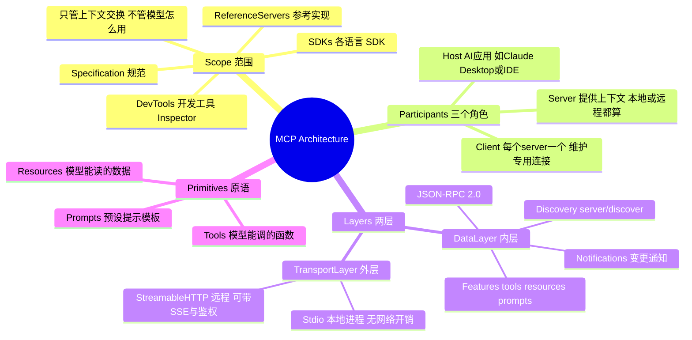

# MCP 架构笔记（对着官方 Architecture 页整理）

> 依据：https://modelcontextprotocol.io/docs/learn/architecture （版本 2026-07-28）
> 用途：D6 概念笔记 + D7 之后面试素材。

---

## 一、思维导图（Mermaid，GitHub 上能直接渲染）



## 二、思维导图（纯文本版，PyCharm 里直接看）

```
MCP Architecture
├── 1. Scope（范围）
│   ├── MCP Specification      规范：客户端和服务端必须满足什么
│   ├── MCP SDKs               各语言实现（Python / TS / ...）
│   ├── MCP Dev Tools          Inspector（调试用）
│   ├── Reference Servers      官方参考实现（filesystem / git / ...）
│   └── 边界：只管"上下文怎么交换"，不管 AI 应用怎么用 LLM
│
├── 2. Participants（三个角色）
│   ├── MCP Host               AI 应用本体（Claude Desktop、Claude Code、IDE、你的 agent）
│   ├── MCP Client             Host 内部，一个 server 对应一个 client，维护专用连接
│   └── MCP Server             提供上下文的程序（本地进程 or 远程服务，都叫 server）
│       ├── 本地 server        stdio 传输，通常只服务一个 client
│       └── 远程 server        Streamable HTTP，通常服务多个 client
│
├── 3. Layers（两层）
│   ├── Data Layer（内层）
│   │   ├── 协议             JSON-RPC 2.0
│   │   ├── Discovery        server/discover：查协议版本、能力、身份
│   │   ├── Server Features  tools / resources / prompts
│   │   ├── Client Features  elicitation（向用户要输入）；sampling 已废弃
│   │   └── Utility          通知（notifications）、进度（progress）
│   └── Transport Layer（外层）
│       ├── Stdio            标准输入输出，同机进程通信，无网络开销
│       └── Streamable HTTP  HTTP POST + 可选 SSE，支持 bearer/API key/OAuth
│
└── 4. Primitives（三类原语）
    ├── Tools        模型可以调用的函数（= 你的 get_weather）
    ├── Resources    模型可以读取的数据（文件、表、文档）
    └── Prompts      预设的交互模板
```

---

## 三、每一块在讲什么

### Participants：一个 Host，多个 Client，多个 Server

关键点是**数量关系**：

```
Host（一个）
 ├── Client A ──── Server A（例如 Sentry，远程）
 └── Client B ──── Server B（例如 filesystem，本地）
```

**每个 server 配一个 client**，不是所有 server 共享一个 client。

官方例子里，VS Code 是 host：连上 Sentry server 时创建一个 client，再连 filesystem server 时又创建一个 client。

### Layers：内层管"说什么"，外层管"怎么说"

| 层 | 负责 | 类比 |
|---|---|---|
| Data layer | 消息内容与语义（JSON-RPC：请求、响应、通知） | 你说的话 |
| Transport layer | 消息怎么送过去（stdio / HTTP） | 用电话还是写信 |

**好处**：换传输方式不用改消息格式。同一个 JSON-RPC 请求，既能走 stdio 也能走 HTTP。

### Data Layer 里最重要的两件事

**① Discovery（发现）**

客户端先发 `server/discover`，问三件事：你支持哪个协议版本？你有什么能力？你是谁？

**这就是"MCP 能自动拿到工具列表"的原理**——工具不是你写死的，是运行时问出来的。

**② Primitives（原语）**

| 原语 | 谁提供 | 吃什么 | 你项目里对应什么 |
|---|---|---|---|
| Tools | server | 模型调用 | `get_weather` / `calculator` / `get_time` |
| Resources | server | 应用读取（不是模型直接调） | 3GPP PDF 原文、告警表 |
| Prompts | server | 应用取用为模板 | 你的 `V2` 提示词 |

**注意 Tools 和 Resources 的区别**：tools 是**模型决定调用**的动作；resources 是**应用决定装载**的数据。这俩混淆，面试会答错。

### Transport：两种连法

| 传输 | 用在 | 特点 |
|---|---|---|
| **Stdio** | 本地进程 | 你的程序启动 server 子进程，用标准输入输出对话；无网络开销 |
| **Streamable HTTP** | 远程服务 | HTTP POST 上行 + 可选 SSE 下行；支持 bearer token / API key / OAuth |

⚠️ 更正一处：我之前口头说过"远程用 HTTP + SSE"。官方现在的名字是 **Streamable HTTP**（POST 为主，SSE 只是可选的流式补充），不是纯粹的 SSE 长连接。

### Notifications：服务端可以主动通知

比如"工具列表变了"，server 主动推给 client，client 再去重新 discovery。

**这在静态 `TOOL_MAP` 里是做不到的**——你的工具列表写死在文件里，改了要重启。

---

## 四、MCP 到底解决了什么问题

对着你 D5 写的代码看，四个具体痛点：

| # | 你现在的状况 | MCP 怎么解 |
|---|---|---|
| 1 | 工具和 agent 写在同一份文件里，换个项目要重抄一遍 | 工具独立成 server，任何 host 都能接 |
| 2 | 加工具要改 `TOOL_MAP` 并重启进程 | `server/discover` 运行时问出来，工具列表可动态变化 |
| 3 | 工具只能跑在你 agent 的进程里，权限无法隔离 | server 是独立进程/服务，可以单独授权、单独限制 |
| 4 | 别人写好的工具（文件、git、数据库）你只能抄代码 | 直接连它的 server，不碰实现 |

**一句话**：MCP 把工具从"你的代码"里搬出来，变成"可发现、可复用、可独立授权"的服务。

**它不解决什么**：不解决"模型会不会选对工具"、不解决"参数对不对"、不解决"联网"。那些是 prompt 设计、schema 设计、工具实现的事。

---

## 五、MCP 和 Function Call 是什么关系

**这两者不在同一层，是"接力"关系。**

```
① 用户在 AI 应用里提问
        ↓
② Host 通过 MCP client 向 server 要工具清单（server/discover）
        ↓
③ Host 把工具清单【翻译成模型的 tools 参数】← Function Call 的协议在这里
        ↓
④ 模型返回 tool_calls（决定调哪个、参数是什么）
        ↓
⑤ Host 把这次调用【翻译成 MCP 的 tools/call 请求】发给 server
        ↓
⑥ server 执行，返回结果
        ↓
⑦ Host 把结果【翻译成 role="tool" 消息】回填给模型
        ↓
⑧ 模型给出最终答案
```

对照你 D4/D5 的代码：

| 步骤 | 你现在（手写） | MCP 版 |
|---|---|---|
| 拿工具清单 | `TOOLS = [...]` 写死 | `server/discover` 问出来 |
| 模型选工具 | `tool_calls` ← **一样** | `tool_calls` ← **一样** |
| 执行 | `TOOL_MAP.get(...)` 调本地函数 | 发 `tools/call` 给 server |
| 回填 | `role="tool"` + `tool_call_id` ← **一样** | 一样 |

**结论**：
- **Function Call 是"模型怎么表达'我要调工具'"** —— 是模型侧的输出格式
- **MCP 是"工具怎么被送到模型面前、怎么被调用"** —— 是应用侧的接入协议
- **MCP 内部一定会用到 Function Call**，但 Function Call 不需要 MCP 也能用（你现在就是）

面试一句话版本：

> 「Function Call 是模型侧的协议，管'模型怎么说出它要调什么'；MCP 是应用侧协议，管'工具从哪来、怎么被发现和调用'。MCP 最终还是要翻译成 tools/tool_calls 给模型。」

---

## 六、你项目里该不该用 MCP

| 场景 | 建议 |
|---|---|
| 主项目 A（3GPP 问答 + 告警查询） | **不用**。3 个工具写死在 `TOOL_MAP` 里更简单，少一个进程、少一层调试 |
| 想让别人也能用你的告警查询 | **用**。做成 server，别人接上就能查 |
| 想接现成工具（filesystem / git / 数据库） | **用**。不用抄代码 |

**能讲清"现阶段为什么不用"比"用了"更能体现判断力。**

---

## 七、三个最容易答错的题

**Q1：MCP 是让模型联网的协议吗？**
不是。MCP 管工具接入，跟联网无关。工具内部写不写 `urlopen` 才决定联不联网。

**Q2：Tools 和 Resources 有什么区别？**
Tools 是**模型决定调用**的动作（要传参、有副作用）；Resources 是**应用决定装载**的数据（只读、可订阅）。

**Q3：有了 MCP 还需要写 Function Call 的解析吗？**
需要。MCP 解决"工具从哪来"，模型输出仍然是 `tool_calls`，你仍然要解析 `arguments`、回填 `tool_call_id`。
