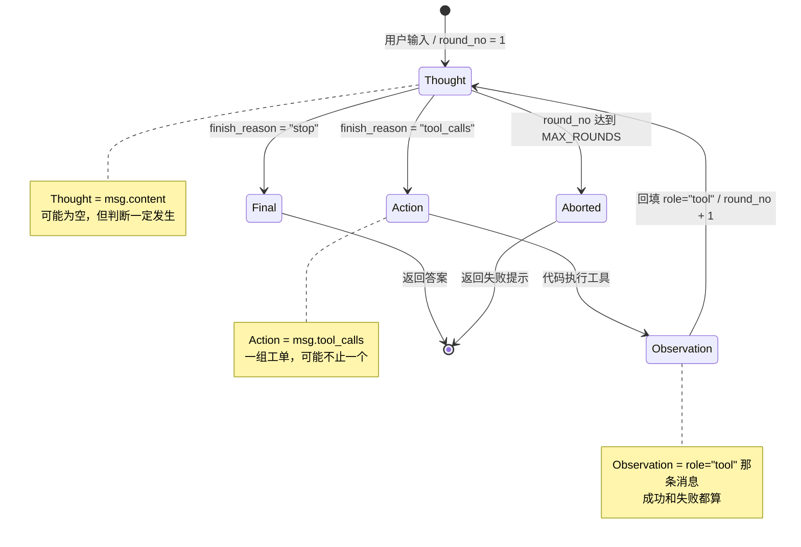

# ReAct 状态机设计（D8）

> 源码参照：`tool_call_demo.py`。本文档只做设计，D9 按此实现。
> 图有两个版本：下面的 Mermaid 源码（GitHub 自动渲染）+ `docs/images/` 里的 draw.io 导出图。

## 一句话

模型每次被调用只有两种结果：**要工具**（`tool_calls`）或**给答案**（`stop`）。
要工具时由我的代码执行并回填，然后模型再想一次——这个往返就是 ReAct。

## 状态机（Mermaid 源码）



## 状态机（手绘版）


## 关键：Action 和 Observation 之间没有 Thought

| 区间 | 谁在干活 |
|---|---|
| `Thought → Action` | 模型决定"我要调工具" |
| `Action → Observation` | **我的代码**：解析参数 → 查表 → 调用 → 拿到结果（或错误） |
| `Observation → Thought` | 我把结果回填，发起下一次请求，模型重新想 |

模型在 `Action → Observation` 这段时间里**什么都没做，它在等**。

## 状态与代码的映射

| 状态 | 代码里是什么 | 位置（`tool_call_demo.py`） |
|---|---|---|
| `Thought` | 模型的 `content`（可能为空）+ 它内部的判断 | `msg.content` / `msg.reasoning_content` |
| `Action` | 模型要求调用的工具清单 | `msg.tool_calls` |
| `Observation` | 我回填的工具结果（成功或失败都算） | `messages.append({"role": "tool", "content": result})` |
| `Final` | 最终答案 | `final_answer = msg.content`（`fr == "stop"` 时） |
| `Aborted` | 超限或异常终止 | `final_answer is None` |

## 三个出口

| 出口 | 触发条件 | 结果 | 现状 |
|---|---|---|---|
| **正常** | `finish_reason == "stop"` | 有答案 | ✅ 已实现 |
| **异常** | `finish_reason` 是 `length` / `content_filter` / `aborted` / `insufficient_system_resource` | 没答案，报错 | ✅ 已实现 |
| **超限** | `round_no` 超过 `MAX_ROUNDS` | 没答案，提示 | ✅ 已实现 |

> ⚠️ 图上 `Aborted` 的标签只写了「round_no 达到 MAX_ROUNDS」，但代码里它从**两个口**进：
> ① 超限 ② `finish_reason` 异常。实现时这两条都要算进 `Aborted`。

## 三条规则（D9 照着实现）

### 1. 重复检测

**指纹怎么算**

```python
fp = f"{tc.function.name}:{json.dumps(args, sort_keys=True, ensure_ascii=False)}"
```

- `sort_keys=True`：让 `{"a":1,"b":2}` 和 `{"b":2,"a":1}` 算同一个指纹——参数顺序不该影响判断
- `ensure_ascii=False`：中文不转成 `\u5317` 这种，日志里能读

**重复了怎么处理**

**不执行工具**，把上一次的结果当 `Observation` 回填，并附一句提示：

```
重复调用：你刚用相同参数调过 get_weather，结果见上一条 tool 消息。请换参数，或直接回答。
```

**措辞是"重复"，不是"失败"**——模型读到"失败"会道歉，读到"重复"会换招。

**同一指纹最多允许几次**

**2 次**。同一输入下工具是确定性的，第 3 次不会有新结果。

**例外：`get_time` 不参与重复检测。** 时间在走，同参数不等于同结果。这条必须有，否则同一次运行里模型连调两次 `get_time`，第二次会被拦住、回填第一次的旧时间。

> 注：当前是"一次运行一个问题"的脚本形态，重复只发生在**同一次运行的多个 round** 之间（D4 实测过 `round=1` 和 `round=2` 都用同参数调 `get_weather`）。等 D23 做成常驻会话后，这条规则才会跨用户提问生效。

### 2. 工具失败策略

当前选择：**不中断**，把错误当 `Observation` 回填。

理由，按重要性排：

1. **错误对模型也是信息。** 实证：「7//2」那次它读到"不支持的表达式片段"，自己把参数改成 `7/2` 重试、再用 3.5 推出向下取整。**如果当时中断，这个任务就死了。**
2. **中断的成本高于重试。** 中断 = 用户拿不到任何东西；回填 = 多花一轮 token，换一次自我修正的机会。
3. **参数错和执行错走同一条通道**（都是 `role="tool"` 的 `content`），模型统一当"这一步的结果"处理，我不用为两类异常写两套逻辑。

代价：多消耗一轮请求（约双倍 token）。**这是设计选择，不是没优化。**

### 3. 代码行号映射（D9 改这里）

| 要加/改 | 位置（`tool_call_demo.py`） | 怎么改 |
|---|---|---|
| `seen = {}` | 第 149 行后（`round_no = 1` 下一行） | 新增一行，跨轮保存"已经调过的指纹" |
| 算指纹 + 查重复 | 第 179 行（`args = json.loads(...)`）**之后** | 算 `fp`；用 `if ... else` 分两支——重复则 `result = "重复调用：..."`，否则走正常校验+执行。**不能用 `continue`**：`for` 末尾还要 append 那条 `role="tool"` 消息，跳过去就 400（每个 tool_call_id 都必须有回复） |
| 记录本次结果 | 第 201 行后（tool 消息 append 完） | `seen[fp] = result` |
| 修一处笔误 | 第 187 行 | `result = result = "参数校验失败：..."` → `result = "参数校验失败：..."` |

**注意**：`fp` 要在 `for tc in msg.tool_calls` **循环内**算，因为一次可能来多个工单，每个工单的指纹不同。
