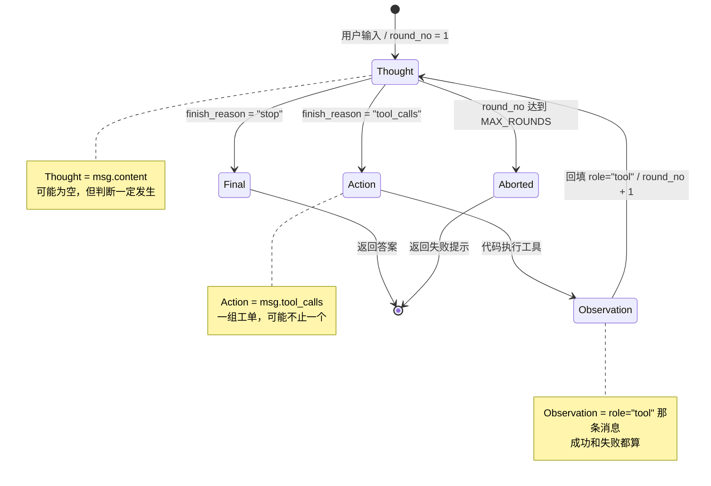
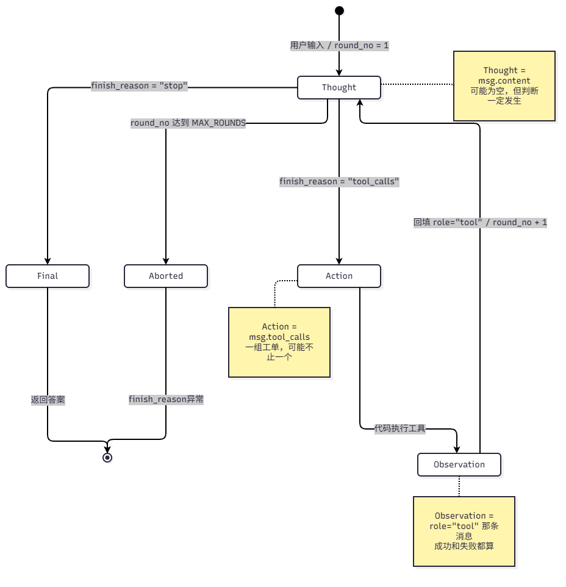

# ReAct 状态机设计（D8）

> 源码参照：`tool_call_demo.py`。本文档只做设计，D9 按此实现。
> 图有两个版本：下面的 Mermaid 源码（GitHub 自动渲染）+ `docs/images/` 里的 draw.io 导出图。

## 一句话

模型每次被调用只有两种结果：**要工具**（`tool_calls`）或**给答案**（`stop`）。
要工具时由我的代码执行并回填，然后模型再想一次——这个往返就是 ReAct。

## 状态机（Mermaid 源码）

## 状态机（手绘版）

## 关键：Action 和 Observation 之间没有 Thought

| 区间 | 谁在干活 |
|---|---|
| `Thought → Action` | 模型决定"我要调工具" |
| `Action → Observation` | **我的代码**：解析参数 → 查表 → 调用 → 拿到结果（或错误） |
| `Observation → Thought` | 我把结果回填，发起下一次请求，模型重新想 |

模型在 `Action → Observation` 这段时间里**什么都没做，它在等**。

## 状态与代码的映射

| 状态 | 代码里是什么 | 位置（`tool_call_demo.py`） |
|---|---|---|
| `Thought` | 模型的 `content`（可能为空）+ 它内部的判断 | `msg.content` / `msg.reasoning_content` |
| `Action` | 模型要求调用的工具清单 | `msg.tool_calls` |
| `Observation` | 我回填的工具结果（成功或失败都算） | `messages.append({"role": "tool", "content": result})` |
| `Final` | 最终答案 | `final_answer = msg.content`（`fr == "stop"` 时） |
| `Aborted` | 超限或异常终止 | `final_answer is None` |

## 三个出口

| 出口 | 触发条件 | 结果 | 现状 |
|---|---|---|---|
| **正常** | `finish_reason == "stop"` | 有答案 | ✅ 已实现 |
| **异常** | `finish_reason` 是 `length` / `content_filter` / `aborted` / `insufficient_system_resource` | 没答案，报错 | ✅ 已实现 |
| **超限** | `round_no` 超过 `MAX_ROUNDS` | 没答案，提示 | ✅ 已实现 |

> ⚠️ 图上 `Aborted` 的标签只写了「round_no 达到 MAX_ROUNDS」，但代码里它从**两个口**进：
> ① 超限 ② `finish_reason` 异常。实现时这两条都要算进 `Aborted`。

## 待填（D8 剩余三步）

### 1. 重复检测规则

- 指纹怎么算：
- 重复了怎么处理：
- 同一指纹最多允许几次：

### 2. 工具失败策略

当前选择：不中断，把错误当 `Observation` 回填。

理由：

### 3. 代码行号映射（D9 要改哪几行）

| 要加/改的 | 位置 | 怎么改 |
|---|---|---|
| 重复检测 | | |
| | | |
